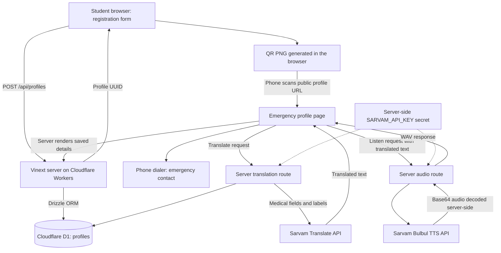

`# Scan2Save

### When you cannot speak, your card can help.

A mobile-friendly emergency information card for students. Create a profile, download its QR code, and let someone scan it to view the details you chose to share, call your emergency contact, and read or hear your medical information in a supported Indian language.

**[Try the live app](https://scan2save-campus-v1.upperlime.chatgpt.site)** · **[GitHub repository](https://github.com/Vatsal2147/Save2Scan)** · **[Sarvam API documentation](https://docs.sarvam.ai/api/getting-started/welcome)**

> Hackathon prototype. Use fictional information for demonstrations. Medical information is self-reported, translations are machine-generated, and the app does not provide diagnosis or treatment advice.

## The problem

A student ID usually helps identify its owner. It may not tell a bystander whom to call, which allergies the owner has recorded, or what medical information the owner wants available when they cannot communicate.

Important information may be scattered across a phone, prescription, or family conversation. Language differences can make that information harder to understand. Scan2Save brings a deliberately selected emergency summary into one browser page, accessible through a QR code on a card or phone.

The project aims to reduce the effort needed to **find, understand, and communicate** that information. It does not claim measured reductions in response time or proven clinical outcomes.

## What it solves

| Need | Scan2Save's approach |
| --- | --- |
| Find emergency information when the owner cannot communicate | A QR links directly to a saved profile. |
| Find someone to contact | A prominent contact name and tap-to-call link. |
| Avoid requiring an app installation | Profiles open in a mobile browser. The current live Site is public and requires no login. |
| Understand information across language barriers | On-demand translation of medical fields through Sarvam. |
| Hear information instead of reading it | On-demand audio in supported speech languages. |
| Help people decide what information to enter | Optional medical sections with explanatory prompts. |
| Keep the source available when interpreting a translation | Original medical details remain visible above the translated result. |

The underlying QR medical-ID concept is established. This project's focus is a simple campus workflow combined with Indian-language text and speech access.

## Demo in one minute

1. Open the [live app](https://scan2save-campus-v1.upperlime.chatgpt.site) on a laptop.
2. Enter fictional student details, an emergency contact, and optional medical information.
3. Confirm the sharing disclosure and create the QR card.
4. Scan the QR with a phone camera and open the profile.
5. Select the language the medical text was entered in and the desired translation language.
6. Select **Translate medical information**, then **Listen** where available.
7. Show the emergency contact button. Tapping it opens the phone dialer; it does not automatically place a call.

Internet access is required. The QR opens a webpage, not a PDF or an offline copy of the record.

## Implemented features

- Student name, college/campus, and a self-reported blood group with an **Unknown** option.
- Optional allergies and medical conditions.
- Six additional optional sections:
  - Current medications, prescribed doses, and frequency.
  - Allergy triggers, reactions, and severity.
  - Prescribed emergency medicines and where they are carried.
  - Past surgeries or major hospital admissions.
  - Implants, medical devices, and accessibility needs.
  - Other medical information or existing clinician-provided care instructions.
- Emergency contact name and telephone number.
- Persistent profile storage, unpredictable UUID profile links, and downloadable QR PNGs.
- A responsive, minimal dark interface for registration and emergency viewing.
- Text translation into 22 scheduled Indian languages, plus English.
- Speech output enabled for 10 Indian languages, plus English.
- Machine-translation notices, self-reported-data labels, and a registration disclosure explaining public access and Sarvam processing.
- Server-side Sarvam credentials: no API key is embedded in browser code.

Blank fields mean **information was not provided**. They must not be interpreted as an absence of allergies, conditions, or medical history.

## Language coverage and verification

### Text translation

The app lists Assamese, Bengali, Bodo, Dogri, Gujarati, Hindi, Kannada, Kashmiri, Konkani, Maithili, Malayalam, Manipuri, Marathi, Nepali, Odia, Punjabi, Sanskrit, Santali, Sindhi, Tamil, Telugu, Urdu, and English.

The user selects both the source and target languages. Source-language detection is not automatic in this implementation. Hindi and Bengali have additional translated result labels; the entire interface is not localized into all languages.

### Audio output

| Language | Code | Live translation and audio test |
| --- | --- | --- |
| English | `en-IN` | Not yet tested |
| Hindi | `hi-IN` | Passed |
| Bengali | `bn-IN` | Passed |
| Gujarati | `gu-IN` | Not yet tested |
| Kannada | `kn-IN` | Not yet tested |
| Malayalam | `ml-IN` | Not yet tested |
| Marathi | `mr-IN` | Passed |
| Odia | `od-IN` | Not yet tested |
| Punjabi | `pa-IN` | Not yet tested |
| Tamil | `ta-IN` | Passed |
| Telugu | `te-IN` | Passed |

Tests performed on **1 November 2026** used fictional peanut-allergy and asthma details. All five tested languages returned successful translation responses and valid WAV audio. Bengali was also exercised through the live browser interface. These are functional checks, not clinical validation or native-speaker pronunciation reviews.

The six additional medical sections were verified to save, render, and translate into Hindi. Not every field/language combination has been tested.

The remaining languages currently have **text translation only** in this app. Text translation coverage must not be confused with text-to-speech coverage. [Sarvam's Bulbul language documentation](https://docs.sarvam.ai/api/api-guides-tutorials/models/bulbul) describes the speech model's supported languages.

## Architecture



### Technology stack

| Layer | Implementation |
| --- | --- |
| Frontend | React 19, TypeScript, custom CSS with Tailwind available, Lucide icons |
| Application framework | Vinext with Next.js App Router-style pages and API routes |
| Server runtime | Cloudflare Workers through the Sites hosting integration |
| Database | Cloudflare D1 / SQLite with Drizzle ORM and SQL migrations |
| QR generation | `qrcode`, running in the browser |
| Translation | Sarvam `sarvam-translate:v1` |
| Speech generation | Sarvam `bulbul:v3`, `shubh` speaker, WAV output |

The frontend does not call Sarvam directly. Profile information is stored in D1; translation and audio are generated on demand rather than precomputed. Names, telephone numbers, and blood groups remain in the original profile and are not part of the medical translation request.

### Application routes

| Route | Purpose |
| --- | --- |
| `/` | Registration and QR creation |
| `/p/[id]` | Public emergency profile |
| `POST /api/profiles` | Validate and persist a new profile |
| `POST /api/profiles/[id]/translate?source=en-IN&target=hi-IN` | Translate saved medical fields and explanatory labels |
| `POST /api/profiles/[id]/audio?target=hi-IN` | Generate speech from submitted translated text |

The audio endpoint expects a JSON body containing `text`. Audio requests are limited to 2,500 characters; long combined medical summaries may need a shorter narration or future chunking support. Translation fields are bounded individually. Invalid language selections and provider failures return controlled errors while the original profile remains readable.

## Sarvam integration

| API | Endpoint | Model | Role |
| --- | --- | --- | --- |
| [Text translation](https://docs.sarvam.ai/api-reference/text/translate-text) | `POST https://api.sarvam.ai/translate` | `sarvam-translate:v1` | Translate user-entered medical fields and result labels. |
| [Text to speech](https://docs.sarvam.ai/api-reference/text-to-speech/convert) | `POST https://api.sarvam.ai/text-to-speech` | `bulbul:v3` | Produce spoken audio of translated medical information. |

Authentication uses the server-side `api-subscription-key` header. The current implementation uses HTTP `fetch`; a Sarvam SDK installation is not required to run the web app.

This is **text translation followed by speech synthesis**, not live microphone translation, speech recognition, a chatbot, or a diagnostic agent.

## Local setup

### Prerequisites

- Node.js **22.13.0 or newer** and npm.
- Git.
- A Sarvam API key with access and sufficient credits for translation and speech.

### 1. Install

```powershell
git clone https://github.com/Vatsal2147/Save2Scan.git
cd Save2Scan
npm run install:ci
```

### 2. Configure the local secret

Create a file named `.dev.vars` in the project root. The following shows the variable name only; paste your own value after `=` locally:

```dotenv
SARVAM_API_KEY=
```

`.dev.vars` is used by the Cloudflare local runtime and is ignored by Git. A generic `.env` file alone is not the configuration path documented for this runtime. Do not use a `NEXT_PUBLIC_` prefix for the key.

| Configuration | Where it is configured | Purpose |
| --- | --- | --- |
| `SARVAM_API_KEY` | Ignored `.dev.vars` locally; a hosting secret in production | Sarvam API authentication |
| `DB` | D1 binding declared in `.openai/hosting.json` | Profile database access; not an API key |

No GitHub, Vercel, OpenAI, or browser-side API key is required by the application. Production secret values and database records are not included in the source ZIP.

### 3. Build and initialize the local database

```powershell
npm run build
```

For a **fresh local database**, apply the committed migrations in order:

```powershell
Get-ChildItem drizzle -Filter '*.sql' | Sort-Object Name | ForEach-Object {
    node --import ./scripts/sites-env.mjs ./node_modules/wrangler/bin/wrangler.js d1 execute DB --local --config dist/server/wrangler.json --persist-to .wrangler/state --file $_.FullName
    if ($LASTEXITCODE -ne 0) { throw 'Database migration failed.' }
}
```

Do not replay migrations already applied to an existing local database. Generate a new migration with `npm run db:generate` only after changing the schema. Local and production databases are separate.

### 4. Start development

```powershell
npm run dev
```

Open the URL printed by the server, normally `http://127.0.0.1:5173`.

`localhost` works on the computer running the server. A phone scanning a localhost QR will try to reach itself. Use the public deployment for the laptop-to-phone demonstration.

### Useful commands

```powershell
npx tsc --noEmit       # Type checking
npm run build         # Production build
npm run dev           # Development server
npm start             # Preview the built Worker locally
npm run db:generate   # Generate migrations after schema changes
```

`scripts/smoke-test.mjs` is a development smoke-check helper tied to a specific local fictional fixture. It is not a portable, comprehensive test suite. Provider tests consume Sarvam credits; run them intentionally.

## Deployment

### Current live deployment

The app is deployed publicly through **Sites on Cloudflare Workers**, with a D1 binding named `DB` and a server-side Sarvam secret. Public access is required for anonymous emergency QR viewing. A newly created Site may default to private access and must be configured explicitly for public viewing.

The tracked `.openai/hosting.json` contains the existing Site identity and binding declaration. Do not reuse its project ID when creating an unrelated deployment. The full Sites publication workflow uses its hosting tooling to build, package, apply migrations, and deploy; `npm run build` alone does not publish the app.

### Vercel status

**This repository is not currently Vercel-ready.** Importing it into Vercel unchanged does not provide a fully working deployment.

A Vercel migration requires standard Next.js build configuration, removal/replacement of Cloudflare-specific runtime integrations, a Vercel-compatible persistent database, corresponding queries and migrations, and server-side environment-variable access. The interface and most application behavior can be reused. That migration has not been completed.

Existing QR codes point to the origin where they were generated. Moving hosting does not automatically move profile data or redirect old QR links.

## Privacy, security, and medical boundaries

- **Profiles are public by link.** Anyone holding or photographing an accessible QR code can open all submitted profile fields. UUIDs reduce guessing; they are not authentication or an emergency-only access control.
- Registration asks for consent to public sharing and Sarvam processing. It also asks the user to have permission to share their emergency contact's details.
- Medical fields selected for translation or narration are sent to Sarvam. This README does not make claims about provider retention or regulatory compliance.
- Secret values stay server-side and out of browser bundles, QR payloads, and source control. The QR contains a profile URL, not the API key or the full medical record.
- Submitted information is unverified. Blood groups, doses, allergies, and clinical history must not be treated as authenticated medical records.
- Machine translation can change meaning or pronunciation. The original remains visible, and native-speaker/clinical review has not been completed.
- This app does not diagnose, recommend treatments, dispatch an ambulance, or guarantee emergency response. Contact emergency services first when needed.
- The prototype has input limits and origin checks, but does not yet have production-grade rate limiting, account ownership, profile editing/deletion, abuse protection, or a complete retention workflow.

Use fictional profiles until appropriate operational, security, privacy, and medical reviews are complete. Because deletion is not implemented, avoid submitting real sensitive information merely to try the demo.

## Current limitations

- Internet-dependent; no offline emergency profile.
- No protected account system, profile editing, or profile deletion.
- No automatic SMS/WhatsApp alerts, location sharing, or emergency dispatch.
- No ABHA integration, institution administration, medical verification, or document uploads.
- Text coverage exceeds speech coverage; not all 22 Indian languages have audio.
- Audio is generated on demand and is not cached. Provider latency, availability, credits, and rate limits affect it.
- Long combined narratives can exceed the speech request limit.
- Most interface text remains English, with specific Hindi/Bengali result labels.
- Saved records and hosted secrets do not transfer by cloning the repository.

## Next steps

- Protected profile ownership, editing, deletion, and a retention policy.
- Stronger abuse controls and request limits for public endpoints.
- Native-speaker review of medical translations and pronunciation.
- Field-level sharing controls and clearer verification/update timestamps.
- Narration chunking and appropriately controlled audio reuse.
- A portable deployment configuration and a completed Vercel/database migration.
- Campus staff evaluation of whether the card fits real emergency workflows.

These are proposed improvements, not implemented features.

## Project structure

```text
app/
  page.tsx                         Registration and QR creation
  globals.css                      Responsive dark interface
  p/[id]/page.tsx                   Emergency profile
  p/[id]/player.tsx                 Translation controls and audio playback
  api/profiles/route.ts             Profile creation
  api/profiles/[id]/translate/      Translation endpoint
  api/profiles/[id]/audio/          Speech endpoint
db/
  index.ts                         D1/Drizzle connection
  schema.ts                        Profile schema
drizzle/                           Committed database migrations
lib/
  languages.ts                     Translation and speech language lists
  medical-fields.ts                Optional medical fields and prompts
  medical-translation.ts           Server-side translation logic
worker/                            Worker entrypoint
scripts/                           Build and runtime integration helpers
.openai/hosting.json                Existing Site identity and bindings
```

---

**Scan2Save makes selected emergency information easier to find and communicate, one scan at a time.**
